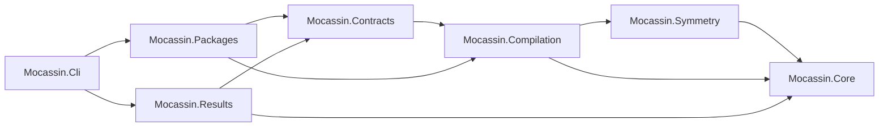
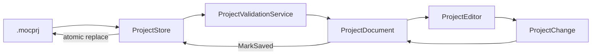

# Architecture of the Domain Kernel

Step 01 introduces the immutable domain kernel and the first persisted format. The guiding rule is that the
kernel describes data and invariants; it does not perform file I/O, SQL, UI work, or simulation.

## Dependency direction

Arrows point from a project to the project it depends on.

`Mocassin.Core` depends only on the base class library. `Mocassin.Packages.Projects` owns project
persistence and depends on `Core`; the kernel never calls the store.

## Kernel namespaces

| Namespace | Responsibility |
| --- | --- |
| `Mocassin.Core.Ids` | Strongly typed UUID identifiers, UUIDv7 generation, reserved IDs, JSON converters. |
| `Mocassin.Core.Geometry` | Fractional/Cartesian primitives, `Vector4I`, public generic vector/matrix math (`Vector3<T>`, `Vector4<T>`, `Matrix3<T>`, `Matrix4<T>`), named geometry tolerances, trim policy. |
| `Mocassin.Core.Units` | Unit value structs, range/finiteness validation, JSON converters. |
| `Mocassin.Core.Diagnostics` | `Diagnostic`, `DiagnosticSeverity`, `ModelPath`, and stable-sorting `DiagnosticBag`. |
| `Mocassin.Core.Model` | Flat particle, particle-set, and structure envelope, template identities, view settings, and `CellParameters`. Later steps add transition, energy, lattice, and simulation sections. |
| `Mocassin.Core.Model.Particles` | `Particle`, `ParticleSet`, in-memory `ParticleModel`, and `IParticleQuery`. |
| `Mocassin.Core.Model.Structure` | `StructureModel`, `SpaceGroupRef`, `CellSite`, `CellDummyPosition`, `SiteStability`, and `IStructureQuery`. |
| `Mocassin.Core.Project` | Project envelope, project/symmetry metadata, JSON context, canonicalizer, model/document/structure hashers, migrations, Core validator. |
| `Mocassin.Core.Editing` | Validated mutations, typed particle/structure edits, undo/redo changes, dirty tracking, autosave timing. |
| `Mocassin.Core.Symmetry` | Persisted `AxisSetting`/`OriginChoice` vocabulary and catalog-derived `CrystalSystem`. |

`Mocassin.Packages.Projects` adds:

| Type | Responsibility |
| --- | --- |
| `ProjectStore` | Load/migrate/validate, atomic save, lock acquisition, autosave recovery files. |
| `ProjectValidationService` | Composes Core, Symmetry, `PROJ034`, and cross-domain `PAR004` validation. |
| `ProjectValidationPipeline` | Load/model/cross-domain/feasibility pipeline; adds `ENM018`, feasibility diagnostics, optional statistics, and the `ValidationResult` consumed by CLI/GUI. |
| `DiagnosticCatalog` | Stable registry of every diagnostic code, owner, help text, and documentation anchor. |
| `ModelStatistics` | Advisory unit-cell/supercell counts and compile-cost estimates from the preview services. |
| `ProjectFileLock` | A held editing lock that removes itself only if it still owns the lock file. |
| `ProjectStoreOptions` | Size cap, backup, stale-lock timeout, autosave interval. |

`Mocassin.Contracts` owns the generated format version constants and the contract manifest reader/checks.
`contracts/manifest.json` remains the source for field names, types, and versions; the project JSON Schema is
generated from it.

## Data flow

1. `ProjectStore.LoadAsync` reads and bounds the file, verifies UTF-8/no BOM, migrates the JSON node, and
   deserializes a `Project`.
2. `ProjectValidationService` composes the Core `ProjectValidator`, the Symmetry `StructureValidator`, the
   `PROJ034` metadata comparison, and the cross-domain `PAR004` warning. `ProjectValidationPipeline` adds
   cross-domain, feasibility, and optional statistics stages and returns one `ValidationResult`. Validation
   diagnostics do not throw; a project with errors is still returned for inspection.
3. `ProjectDocument` wraps the loaded value as both current and last-saved. `ProjectEditor.Apply` validates a
   candidate mutation and returns a new immutable project plus one `ProjectChange`.
4. The application saves the current project through `ProjectStore` and calls `MarkSaved` with the returned
   value, which includes the updated `modifiedUtc`.

## Symmetry foundation (Step 02)

`Mocassin.Core` owns the persisted symmetry vocabulary (`AxisSetting`, `OriginChoice`), the catalog-derived
`CrystalSystem`, and the coordinate primitives. `Mocassin.Symmetry` owns the catalog, exact operations, cell
geometry, P1 encoding, reduction, and periodic geometry. Core never references Symmetry.

The Symmetry project is grouped by responsibility: `Contracts/` (version records), `SpaceGroups/` (catalog,
operations, orbit helpers), `Geometry/` (cell, grid, encoder, periodic geometry), `Reduction/` (point groups,
pair and cluster reduction), `Diagnostics/`, and `Caching/`.

### Catalog generation and embedding

The committed catalog is generated from pinned spglib by `tools/symmetry/generate_space_groups.py`. Normal
builds embed `src/dotnet/Mocassin.Symmetry/Data/space-groups.json` and its SHA-256 as resources; they never
run Python, spglib, or network access. The loader verifies the checksum, schema version, data version, 230/274
counts, identity, determinants, and normalized translations at startup. The Contracts and policy CI job
regenerates the canonical payload and fails on drift. Provenance and licensing are in `Data/README.md` and
`NOTICE.md`.

### Exact grid and P1 order

Discrete symmetry uses the internal `24 × 10^12` grid. The canonical P1 order is a format contract: expand,
trim, exact-grid deduplicate, sort by fractional `(a, b, c)`, and assign `P`. The encoder owns the linear-index
cap and exact `Vector4I` mapping. See [Compilation Pipeline](compilation-pipeline.md) and
[Symmetry and Geometry](../physics/symmetry.md).

### Caches and versions

Compilation caches are scoped to one compilation and keyed by catalog version, contract version, setting
identity, and operation inputs. `SymmetryContract.Version = "symmetry-1"` covers grid, P1 order, reduction,
buckets, and codes. Compiled packages record the contract version, catalog data version, and catalog SHA-256
through `SymmetryVersionInfo`; the project may carry advisory metadata that warns `PROJ034` on mismatch. The
structure-preview cache is scoped to the preview service and keyed by the canonical structure hash, the
requested cell counts, the catalog data version/SHA-256, and the contract version.

## Particle and structure model (Step 03)

`Mocassin.Core` owns the persisted particle and structure model:

- `Particle`, `ParticleSet`, and the in-memory `ParticleModel` grouping;
- `StructureModel`, `SpaceGroupRef`, `CellSite`, `CellDummyPosition`, and `SiteStability`;
- `ModelDefinition` with flat `particles`, `particleSets`, and `structure` sections;
- `IParticleQuery`/`IStructureQuery` implemented by the immutable `Project` snapshot;
- typed `ProjectEditor` operations for particles, sets, structure name, space group, cell parameters, sites,
  and dummies.

`Mocassin.Symmetry` owns the catalog-dependent work:

- resolving `(number, axis, origin)` against the embedded catalog;
- cell and crystal-system validation;
- P1 expansion and exact-grid orbit overlap;
- `StructurePreview`, `StructurePreviewService`, and `StructureValidator`.

Core never references Symmetry. `Mocassin.Packages.Projects.ProjectValidationService` composes Core
validation, Symmetry structure validation, the `PROJ034` metadata comparison, and the cross-domain `PAR004`
warning into one stable diagnostic list. `ProjectStore` uses that composed validator by default; the editor
keeps the Core-only default and the UI/CLI pass the composed validator explicitly.

The project JSON stores `Fractional3` as `[a, b, c]`, writes enums as camelCase strings, omits the computed
`isVoid` field, and sorts `particles`, `particleSets`, `sites`, and `dummyPositions` by ID in canonical form.
`ParticleSet.ParticleIds` order remains semantic. `ModelDefinition.Empty` supplies the default structure for
`"model": {}` and for missing model sections. See [Project Format](../reference/project-format.md) and
[Symmetry and Geometry](../physics/symmetry.md).

## Editing and immutability

Project data uses records and `ImmutableArray<T>`. Editing never mutates a project in place:

- a mutation is a pure `Project -> Project` function;
- the candidate is validated before it is committed;
- errors leave the document unchanged;
- a successful edit clears the redo stack and records one undo step;
- bulk operations are a single mutation and therefore one undo step.

`ProjectEditor.Apply` remains the generic validated path. Step 03 adds typed helpers such as `AddParticle`,
`UpdateCellSite`, `SetSpaceGroup`, and `AddDummyPosition`, which use the same validation/commit path. A failed
typed edit returns the unchanged project with diagnostics; missing update/remove identifiers produce
`PROJ010`.

## Errors

- User-data problems produce `Diagnostic` values with stable codes and `ModelPath` locations.
- Exceptions are reserved for programmer errors, I/O faults, and contract violations.
- The project store converts I/O failures into `PROJ030`/`PROJ031`/`PROJ033` diagnostics and never truncates a
  valid file.

## Format ownership

The project format is a cross-language contract even though only .NET writes it. Rust and Python never read
`.mocprj`; they consume compiled packages and states. The project schema is therefore owned by the .NET model
builder and documented in [Project Format](../reference/project-format.md).

## Testing

- `Mocassin.Core.Tests` covers IDs, units, diagnostics, canonical JSON, migrations, validation, editing, and
  schema/property tests.
- `Mocassin.Packages.Tests` uses real temporary directories and files for atomic save, failure injection,
  lock contention, stale-lock recovery, and autosave.
- Contract fixtures are generated by the real writer and validated against the generated JSON Schema.
