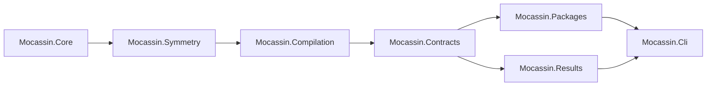
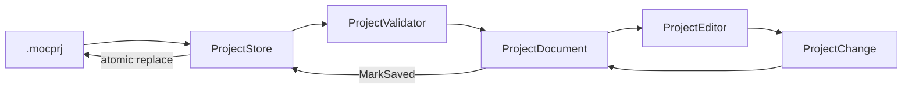

# Architecture of the Domain Kernel

Step 01 introduces the immutable domain kernel and the first persisted format. The guiding rule is that the
kernel describes data and invariants; it does not perform file I/O, SQL, UI work, or simulation.

## Dependency direction

`Mocassin.Core` depends only on the base class library. `Mocassin.Packages.Projects` owns project
persistence and depends on `Core`; the kernel never calls the store.

## Kernel namespaces

| Namespace | Responsibility |
| --- | --- |
| `Mocassin.Core.Ids` | Strongly typed UUID identifiers, UUIDv7 generation, reserved IDs, JSON converters. |
| `Mocassin.Core.Geometry` | Fractional/Cartesian primitives, `Vector4I`, public generic vector/matrix math (`Vector3<T>`, `Vector4<T>`, `Matrix3<T>`, `Matrix4<T>`), named geometry tolerances, trim policy. |
| `Mocassin.Core.Units` | Unit value structs, range/finiteness validation, JSON converters. |
| `Mocassin.Core.Diagnostics` | `Diagnostic`, `DiagnosticSeverity`, `ModelPath`, and stable-sorting `DiagnosticBag`. |
| `Mocassin.Core.Model` | Model envelope placeholder, template identities, view settings, and `CellParameters`. Steps 03–10 extend it. |
| `Mocassin.Core.Project` | Project envelope, metadata, JSON context, canonicalizer, hashers, migrations, validator. |
| `Mocassin.Core.Editing` | Validated mutations, undo/redo changes, dirty tracking, autosave timing. |
| `Mocassin.Core.Symmetry` | Persisted `AxisSetting`/`OriginChoice` vocabulary and catalog-derived `CrystalSystem`. |

`Mocassin.Packages.Projects` adds:

| Type | Responsibility |
| --- | --- |
| `ProjectStore` | Load/migrate/validate, atomic save, lock acquisition, autosave recovery files. |
| `ProjectFileLock` | A held editing lock that removes itself only if it still owns the lock file. |
| `ProjectStoreOptions` | Size cap, backup, stale-lock timeout, autosave interval. |

`Mocassin.Contracts` owns the generated format version constants and the contract manifest reader/checks.
`contracts/manifest.json` remains the source for field names, types, and versions; the project JSON Schema is
generated from it.

## Data flow

1. `ProjectStore.LoadAsync` reads and bounds the file, verifies UTF-8/no BOM, migrates the JSON node, and
   deserializes a `Project`.
2. `ProjectValidator` checks metadata, identifiers, references, and view settings. Validation diagnostics do
   not throw; a project with errors is still returned for inspection.
3. `ProjectDocument` wraps the loaded value as both current and last-saved. `ProjectEditor.Apply` validates a
   candidate mutation and returns a new immutable project plus one `ProjectChange`.
4. The application saves the current project through `ProjectStore` and calls `MarkSaved` with the returned
   value, which includes the updated `modifiedUtc`.

## Symmetry foundation (Step 02)

`Mocassin.Core` owns the persisted symmetry vocabulary (`AxisSetting`, `OriginChoice`), the catalog-derived
`CrystalSystem`, and the coordinate primitives. `Mocassin.Symmetry` owns the catalog, exact operations, cell
geometry, P1 encoding, reduction, and periodic geometry. Core never references Symmetry.

### Catalog generation and embedding

The committed catalog is generated from pinned spglib by `tools/symmetry/generate_space_groups.py`. Normal
builds embed `src/dotnet/Mocassin.Symmetry/Data/space-groups.json` and its SHA-256 as resources; they never
run Python, spglib, or network access. The loader verifies the checksum, schema version, data version, 230/274
counts, identity, determinants, and normalized translations at startup. The Contracts and policy CI job
regenerates the canonical payload and fails on drift. Provenance and licensing are in `Data/README.md` and
`NOTICE.md`.

### Exact grid and P1 order

Discrete symmetry uses the internal `24 × 10^12` grid. The canonical P1 order is a format contract: expand,
trim, exact-grid deduplicate, sort by fractional `(a, b, c)`, and assign `P`. The encoder owns the linear-index
cap and exact `Vector4I` mapping. See [Compilation Pipeline](compilation-pipeline.md) and
[Symmetry and Geometry](../physics/symmetry.md).

### Caches and versions

Caches are scoped to one compilation and keyed by catalog version, contract version, setting identity, and
operation inputs. `SymmetryContract.Version = "symmetry-1"` covers grid, P1 order, reduction, buckets, and
codes. Compiled packages record the contract version, catalog data version, and catalog SHA-256 through
`SymmetryVersionInfo`; the project may carry advisory metadata that warns `PROJ034` on mismatch.

Project data uses records and `ImmutableArray<T>`. Editing never mutates a project in place:

- a mutation is a pure `Project -> Project` function;
- the candidate is validated before it is committed;
- errors leave the document unchanged;
- a successful edit clears the redo stack and records one undo step;
- bulk operations are a single mutation and therefore one undo step.

The editor is deliberately generic in Step 01. Typed helpers such as `AddParticle`, `UpdateCellSite`, and
`AddTransition` are added with the corresponding model steps and use the same validation/commit path.

## Errors

- User-data problems produce `Diagnostic` values with stable codes and `ModelPath` locations.
- Exceptions are reserved for programmer errors, I/O faults, and contract violations.
- The project store converts I/O failures into `PROJ030`/`PROJ031`/`PROJ033` diagnostics and never truncates a
  valid file.

## Format ownership

The project format is a cross-language contract even though only .NET writes it. Rust and Python never read
`.mocprj`; they consume compiled packages and states. The project schema is therefore owned by the .NET model
builder and documented in [Project Format](../reference/project-format.md).

## Testing

- `Mocassin.Core.Tests` covers IDs, units, diagnostics, canonical JSON, migrations, validation, editing, and
  schema/property tests.
- `Mocassin.Packages.Tests` uses real temporary directories and files for atomic save, failure injection,
  lock contention, stale-lock recovery, and autosave.
- Contract fixtures are generated by the real writer and validated against the generated JSON Schema.
