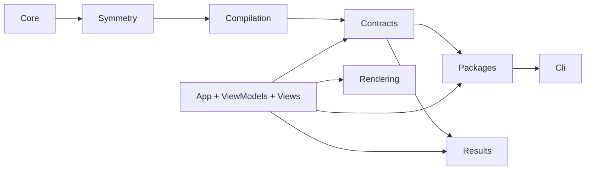

# Development

Developer documentation for the reimplementation.

## Architecture

The repository separates concerns into three languages and one set of contracts:

- .NET owns the model builder, compilation, package writer, results API, CLI, and Avalonia application.
- Rust owns the solver, `.msl` reader, RNG, state writer, and solver CLI.
- Python owns the read-only analysis package.
- `contracts/manifest.json` is the machine-readable source for shared fields, types, and versions.

The detailed architecture is in the internal plan; the repository layout is summarized in
[Reference → Repository and file layout](../reference/file-layout.md).

## Guides

- [Architecture](architecture.md) — immutable domain kernel, dependency direction, project store/edit split.
- [Code structure](code-structure.md) — folder ownership, file naming, limits, and the structure test.
- [Design decisions](design-decisions.md) — stable IDs, explicit units, canonical hashing, locking, and schema ownership.
- [Contributing](contributing.md) — branches, review gates, local quality gates, tests, and docs-as-code.
- [Agent workflow](agent-workflow.md) — context handoff, prompts, evidence reports, and diff review.
- [Testing and parity](testing-and-parity.md) — testing trophy, mocks/fakes policy, fixtures, and test tiers.

## Current phase

Step 00 created the build/test/docs skeleton. Step 01 adds the immutable project kernel and `.mocprj` format.
Scientific model domains, the solver, and the GUI are added in later steps. Do not treat placeholder pages as
implemented features.
