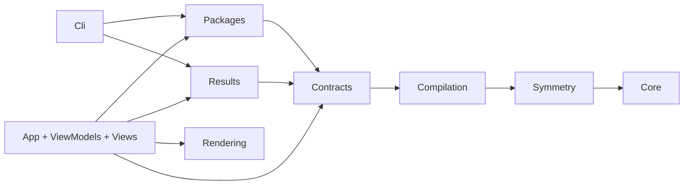

# Development

Developer documentation for the reimplementation.

## Architecture

The repository separates concerns into three languages and one set of contracts:

Arrows point from a project to the project it depends on.

- .NET owns the model builder, compilation, package writer, results API, CLI, and Avalonia application.
- Rust owns the solver, `.msl` reader, RNG, state writer, and solver CLI.
- Python owns the read-only analysis package.
- `contracts/manifest.json` is the machine-readable source for shared fields, types, and versions.

The detailed architecture is in the internal plan; the repository layout is summarized in
[Reference → Repository and file layout](../reference/file-layout.md).

## Guides

- [Architecture](architecture.md) — immutable domain kernel, dependency direction, project store/edit split.
- [UI architecture](ui-architecture.md) — App/Views/ViewModels split, composition root, I/O boundary, documents,
  navigation, sessions, settings, and the headless test harness.
- [Code structure](code-structure.md) — folder ownership, file naming, limits, and the structure test.
- [Design decisions](design-decisions.md) — stable IDs, explicit units, canonical hashing, locking, and schema ownership.
- [Compilation pipeline](compilation-pipeline.md) — symmetry, transitions, energy, lattice/simulation input, and how
  Step 10/11 consume it.
- [Solver architecture](solver-architecture.md) — Rust crates, bounded `.msl` reader, runtime model, RNG streams,
  and the `mocassin-sim` foundation.
- [Contributing](contributing.md) — branches, review gates, local quality gates, tests, and docs-as-code.
- [Agent workflow](agent-workflow.md) — context handoff, prompts, evidence reports, and diff review.
- [Orchestration and role delegation](orchestration.md) — orchestrator role, spawning, and handoff rules.
- [Drift checks](drift-checks.md) — lightweight monthly and phase-boundary checks between cross-cutting reviews.
- [Agent security](agent-security.md) — threat model, permissions, secrets, and prompt injection.
- [Incident and rollback](incident-and-rollback.md) — severity, rollback, hotfix, and postmortem rules.
- [Testing and parity](testing-and-parity.md) — testing trophy, mocks/fakes policy, fixtures, and test tiers.

## Current phase

Steps 00–13 are complete: the build/test/docs skeleton, the immutable project kernel and `.mocprj` format, the
symmetry/geometry kernels, the particle/structure/transition/energy models, the lattice/simulation models,
validation, diagnostics, model statistics, the Phase C compilation pipeline, and the Rust solver foundation and
package reader. Step 23A — the Avalonia workspace and project lifecycle — is at closeout/audit; Step 23B adds
editing, validation surfaces, autosave, and recovery. The model editors, solver engines, results UI, 3D viewer,
and run monitoring are later steps. Do not treat placeholder pages as implemented features.
