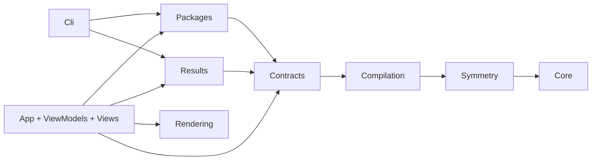

# Development

Developer documentation for the reimplementation.

## Architecture

The repository separates concerns into three languages and one set of contracts:

Arrows point from a project to the project it depends on.

- .NET owns the model builder, compilation, package writer, results API, CLI, and Avalonia application.
- Rust owns the solver, `.msl` reader, RNG, state writer, and solver CLI.
- Python owns the read-only analysis package.
- `contracts/manifest.json` is the machine-readable source for shared fields, types, and versions.

The detailed architecture is in the internal plan; the repository layout is summarized in
[Reference → Repository and file layout](../reference/file-layout.md).

## Guides

- [Architecture](architecture.md) — immutable domain kernel, dependency direction, project store/edit split.
- [UI architecture](ui-architecture.md) — App/Views/ViewModels split, composition root, I/O boundary, documents,
  navigation, sessions, settings, and the headless test harness.
- [UI interaction contract](ui-interaction-contract.md) — proportional panel layout, overlay focus and
  modality, and the `Enter`/`Escape` mapping for the shell, dialogs, and future editors.
- [UI visual contract](ui-visual-contract.md) — token palette, typography, card chrome, interaction states,
  console tabs, and the contrast/focus floor for both themes.
- [Code structure](code-structure.md) — folder ownership, file naming, limits, and the structure test.
- [Design decisions](design-decisions.md) — stable IDs, explicit units, canonical hashing, locking, and schema ownership.
- [Compilation pipeline](compilation-pipeline.md) — symmetry, transitions, energy, lattice/simulation input, and how
  Step 10/11 consume it.
- [Solver architecture](solver-architecture.md) — Rust crates, bounded `.msl` reader, runtime model, RNG streams,
  and the `mocassin-sim` foundation.
- [Contributing](contributing.md) — branches, review gates, local quality gates, tests, and docs-as-code.
- [Agent workflow](agent-workflow.md) — context handoff, prompts, evidence reports, and diff review.
- [Orchestration and role delegation](orchestration.md) — lead role, spawning, model tiers, and handoff rules.
- [Model economics](model-economics.md) — model tiers, role assignment, free-first binding, escalation, and cost
  guardrails.
- [Design proportionality](design-proportionality.md) — `Full`/`Light`/`None` design classes, the review stop rule,
  and the pre-audit gate.
- [Senior focused consultation](senior-consultation.md) — advisory escalation after two completed standard
  rounds still leave a Blocker or Major; not a round and not a verdict.
- [Drift checks](drift-checks.md) — lightweight monthly and phase-boundary checks between cross-cutting reviews.
- [Agent security](agent-security.md) — threat model, permissions, secrets, and prompt injection.
- [Incident and rollback](incident-and-rollback.md) — severity, rollback, hotfix, and postmortem rules.
- [Testing and parity](testing-and-parity.md) — testing trophy, mocks/fakes policy, fixtures, and test tiers.
- [Platform checklist](platform-checklist.md) — automated Windows/macOS headless gates and the manual
  real-window checklist.

## Task disciplines

Short task-level practices with a matching skill trigger. Each page links the normative rule for the related
repository area instead of restating it.

- [Codebase design](codebase-design.md) — deep modules, seams, interfaces, and the deletion test.
- [Diagnosing bugs](diagnosing-bugs.md) — a red-capable loop, minimisation, falsifiable hypotheses, and regression
  tests.
- [Domain language](domain-language.md) — the root glossary, the published glossary boundary, and when to write an
  ADR.
- [Discovery and grilling](discovery.md) — frontier rounds, the question budget, and the round format.
- [Prototypes](prototypes.md) — one question, throwaway code, and a recorded decision.
- [Research](research.md) — primary sources, citations, and cited notes under `docs/planning/research/`.
- [Review axes](review-axes.md) — Standards and Spec, one label per finding, and one verdict.
- [Test-driven development](tdd.md) — agree the seam, red-green, and test quality.
- [Retrospectives](retrospectives.md) — improving the agent environment after a step or session.

## Current phase

Steps 00–14 are complete: the build/test/docs skeleton, the immutable project kernel and `.mocprj` format, the
symmetry/geometry kernels, the particle/structure/transition/energy models, the lattice/simulation models,
validation, diagnostics, model statistics, the Phase C compilation pipeline, the Rust solver foundation and
package reader, and the simulation-context initialization. Step 23A — the Avalonia workspace and project
lifecycle — is complete and tagged `step-23a`; Step 23B adds editing, validation surfaces, autosave, and recovery
and is in closeout. The model editors, remaining solver engines, results UI, 3D viewer, and run monitoring are
later steps. Do not treat placeholder pages as implemented features.
