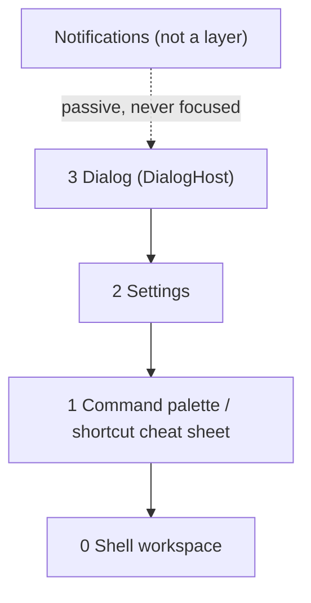

# UI Interaction Contract

This page is the normative home for how the desktop shell lays out its panels and how focus, `Enter`, and
`Escape` behave in the shell, its overlays, and its dialogs. The project split and composition rules are in
[UI architecture](ui-architecture.md); this page covers behaviour at the keyboard and window edge.

It applies to `Mocassin.App.Views` and the view models those views bind to, and to every editor added in
Steps 24–28. A view that cannot follow a rule must say why in its step page and add a test for the exception.

## 1. Framework baseline

The shell targets Avalonia 12.1.6. The rules below rely on the behaviour of that version:

- `Button.IsDefault` and `Button.IsCancel` register a `KeyDown` handler on the button's **visual root**
  (`Button.RootDefaultKeyDown` / `RootCancelKeyDown`). They fire on `Enter`/`Escape` whenever the button is
  effectively visible and enabled, regardless of which control currently has focus. Default and cancel buttons
  are therefore scoped to the top-level window, not to a panel or dialog subtree.
- `TextBox` consumes `Enter` only when `AcceptsReturn` is `true`, and it consumes `Ctrl+Enter` the same way
  because its `Key.Enter` branch does not inspect modifiers. A single-line field lets `Enter` bubble to the
  default action; a multiline field must have `Ctrl+Enter` intercepted before the text box sees it.
- Popups and flyouts are separate top-levels. They receive `Escape` before the owner window and dismiss
  themselves, so the window must not pre-empt them with a tunnel handler.
- `GridSplitter` is focusable through the Fluent theme, supports arrow-key resizing, and converts every star
  track to a pixel-valued star while dragging. Proportions must therefore be re-normalised and persisted by
  the shell rather than read back from the grid.

Consequences:

- At most one overlay may expose default or cancel buttons at a time, because all overlays live in the same
  window.
- `Escape` routing must be decided after focused controls and open popups have had a chance to handle it.
- A proportional layout needs an explicit fractions model; the splitter's own pixel edits are not durable.

## 2. Layers and modality

The shell window is a stack of layers. Only the topmost open layer is interactive.



| Layer | Open state | Initial focus | Participates in `Escape` | Default action |
| --- | --- | --- | --- | --- |
| 0 Shell workspace | always | application default | no | none |
| 1 Command palette | `ShellViewModel.IsPaletteOpen` | search box | yes | execute selection |
| 1 Shortcut cheat sheet | `ShellViewModel.IsCheatSheetOpen` | Close button | yes | Close |
| 2 Settings | `SettingsViewModel.IsOpen` | first editable field (Theme) | yes | Save |
| 3 Dialog | `DialogHost` has a current dialog | view-declared target | yes, if dismissible | the view's `IsDefault` button |
| — Notifications | any | never | no | explicit Close button only |

Rules:

1. **One interactive layer.** When a layer opens, the shell workspace, the notification host, and every other
   overlay are set `IsEnabled="false"`. Closing the layer re-enables them. Disabling is what keeps Tab inside
   the top layer and prevents a lower layer's default or cancel button from firing; no custom focus trap is
   needed. This is a modality state, not a theme change: no colour, font, density, or motion resource is
   modified.
2. **Command gestures are modal.** While any layer is open, the shell command catalog's key gestures are
   inert. Typing, Tab, arrow keys, `Enter`, and `Escape` keep working inside the layer. A command that needs
   to run from an overlay must be exposed as an overlay-local control, not as a shell gesture.
3. **Palette and cheat sheet are exclusive.** Opening one closes the other. Opening settings closes both.
   A dialog may open above any layer; it disables that layer and restores it on close.
4. **Notifications are passive.** They are not a layer, never take focus, never handle `Escape` or `Enter`,
   and are disabled while a layer is open. They close only through their own button.
5. **No overlapping default buttons.** Because a dialog can appear asynchronously over settings, the settings
   layer is disabled while the dialog is open; its `IsDefault`/`IsCancel` buttons are therefore inert until
   the dialog closes.

## 3. Focus lifecycle

### 3.1 Opening

Before a layer becomes visible, the shell captures `FocusManager.GetFocusedElement()`. After layout, it moves
focus to the layer's initial target:

| Surface | Initial focus |
| --- | --- |
| Command palette | `SearchBox`; existing query selected so the first keystroke replaces it |
| Shortcut cheat sheet | Close button |
| Settings | Theme combo box, the first editable control; never Save |
| Confirmation dialog | Cancel button, declared explicitly |
| Choice dialog | the choice list |
| Text prompt dialog | the text box |
| Error dialog | Close button |
| Progress dialog | the dialog container, so `Enter` cannot trigger Cancel |
| Crash dialog | the first recovery action, else the first focusable control |
| Notification host | none |

The focus move is posted to the UI thread and re-checks that the layer is still open. Removing every overlay's
own "focus when visible" side effect is part of the fix; a visibility binding on a child control does not change
when an ancestor becomes hidden, so such handlers cannot be the primary mechanism.

Dialogs declare their target with an attached `DialogFocus.InitialFocus` marker. `True` on a control selects
that control; `Container` on the dialog root selects the host container. `DialogHost` focuses the first marked
target, else the first focusable descendant, else the dialog container. The container is normally only a
fallback and must not be the initial focus while an actionable control exists; the progress dialog uses
`Container` deliberately because it has no dismiss action.

### 3.2 Closing

On close, focus returns to the captured element when it is still attached, visible, and enabled. The fallback
order is:

1. the element that was focused before the layer opened;
2. the active document tab strip (`Document tabs`);
3. the main menu.

Closing a layer must not leave focus on a hidden element, on the layer root, or on nothing. The captured
element is restored **after** the layer below is re-enabled, so a control inside the disabled subtree becomes
focusable again first.

### 3.3 Asynchronous dialogs

`DialogHost` raises an open notification after it has captured the previous focus and before it posts the
initial focus. It raises the close notification before restoring focus. The window uses those notifications to
disable and re-enable the layer underneath. A dialog that appears while settings is open must not steal or
lose the settings draft.

## 4. Escape

`Escape` is routed by one window-level handler in the **bubble** phase when the event is not already handled.
The bubble phase lets an open combo box, menu, or flyout close itself first. A layer may keep its own local
handler in front of the window router (the dialog host does), but a window-level tunnel handler must not
pre-empt popups.

Priority, highest first:

1. **Dialog.** If the dialog can cancel, cancel it. If it cannot (progress, crash), consume `Escape` and do not
   fall through. A progress operation is cancelled through its explicit Cancel button, not by dismissing the
   dialog; a crash dialog has no dismiss path.
2. **Settings.** Cancel the dialog. Unapplied edits are discarded exactly as if Cancel had been clicked; the
   dialog persists nothing until Save, and the visible Cancel button is the explicit equivalent.
3. **Command palette.** Close it. No command executes.
4. **Shortcut cheat sheet.** Close it.
5. **No layer.** Do nothing and leave the event unhandled.

`Escape` never clears a text field, never reverts an applied project edit, and never dismisses a notification.
`Escape` is consumed by the layer it closes, so one key press closes exactly one layer.

## 5. Enter

### 5.1 Principle

`Enter` activates the focused control's own action first. If the focused control does not consume it, the
topmost layer's default action runs. A layer may have at most one `IsDefault` button and at most one
`IsCancel` button. The safe action must be the initial focus, not necessarily the default button.

### 5.2 Mapping by control class

| Focused control | Plain `Enter` | `Ctrl+Enter` |
| --- | --- | --- |
| Button | click that button | same as `Enter` |
| Dialog with a default button, focus elsewhere | run the default action | same as `Enter` |
| Single-line `TextBox` | commit the field when it defines a commit action; otherwise run the layer's default action | same as `Enter` |
| Multiline `TextBox` (`AcceptsReturn="True"`) | insert a newline | commit the editor (see 5.3) |
| Read-only `TextBox` | no state change | no state change |
| Closed `ComboBox` | open the list | open the list |
| Open `ComboBox` | commit the highlighted item and close the list | commit the highlighted item |
| `ListBox`/`TreeView` with a selection | activate the selected item (open, navigate, or run its command) | same as `Enter` |
| `ListBox`/`TreeView` with no selection | no-op | no-op |
| Menu | activate the highlighted menu item | no-op |
| `TabControl` | no-op; selection is arrow/click driven | no-op |
| `CheckBox`/`RadioButton` | toggle the control (the `Button` base class handles `Enter`) | same as `Enter` |
| `Slider` | no value change; arrows adjust | no-op |
| `GridSplitter` | toggle focus engagement where XY navigation is enabled | no-op |
| Notification host | never focused | — |

Mapping rules:

- **Command palette.** `Enter` executes the selected command and closes the palette. With no results it is a
  no-op and the palette stays open. The handler is on the palette root, so `Enter` works with focus in the
  search box or in the results list; arrows keep their normal behaviour.
- **Cheat sheet.** `Enter` activates Close (the only button).
- **Settings.** `Enter` activates the focused control, otherwise Save. `Enter` in a combo box opens or commits
  the list rather than saving.
- **Confirmation dialogs.** The initial focus is Cancel, so plain `Enter` cancels. Confirming a destructive or
  discarding action requires tabbing to the confirm button and pressing `Enter`; it is never the default on
  open.
- **Errors.** `Enter` and `Escape` both close the dialog.
- **Progress.** `Enter` does nothing unless focus has deliberately moved to the Cancel button; the initial
  focus is the container. `Escape` does not close the dialog.
- **Crash.** `Enter` activates the focused recovery or exit action; there is no cancel route.
- **Lists and trees.** The palette, Validation list, and explorer implement activation explicitly. The internal
  channel id and type names remain `problems`; the visible label is Validation. A new list or tree that offers a
  double-click action must offer the same action on `Enter`.

### 5.3 Multiline opt-out

A multiline editor keeps `Enter` for a newline and confirms with `Ctrl+Enter`. Because `TextBox` consumes
`Ctrl+Enter` as a newline when `AcceptsReturn="True"`, the editor must handle it in the **tunnel** phase (on
the editor or an ancestor) and mark it handled before the text box's `OnKeyDown` runs. The editor must:

- expose one commit command and route both `Ctrl+Enter` and its Save button to it;
- keep plain `Enter` inserting a newline;
- never treat a modifier-only difference as two separate code paths;
- add a headless test that asserts the newline count changes on `Enter` and the value commits on `Ctrl+Enter`.

Steps 24–28 editors must follow this rule from their first implementation. The shell has no editable multiline
field today (the project JSON view is read-only), so the first such editor owns the first test.

### 5.4 Controls that must not confirm on plain `Enter`

- multiline editors, including any future notes, scripts, messages, or structured-text editors;
- an open `ComboBox`, where `Enter` commits the list item;
- menus, where `Enter` activates the highlighted item;
- non-dismissible progress and crash dialogs beyond their explicit buttons;
- a focused Cancel or destructive-confirm button, where that button's own action wins instead of the layer's
  default;
- splitter focus engagement and any other control whose `Enter` action is defined by the framework.

A focused check box or radio button toggles on `Enter`; `Space` remains the conventional alternative. A focused
slider does not confirm anything and leaves `Enter` to the layer default.

## 6. Shell layout

### 6.1 Proportional model

The workspace is a three-column grid and a two-row centre:

```text
┌──────────┬─┬──────────────────────────┬─┬──────────┐
│ projects │ │ documents                │ │ inspector│
│          │ ├──────────────────────────┤ │          │
│          │ │ console                  │ │          │
└──────────┴─┴──────────────────────────┴─┴──────────┘
```

The left, centre, and right columns are star tracks. The centre column is split into star rows for documents
and console. The shell stores **fractions**, never pixels:

| Value | Meaning | Default | Minimum |
| --- | --- | --- | --- |
| `LeftFraction` | projects panel share of the workspace width | 0.20 (240 px nominal at 1200) | 160 px |
| `RightFraction` | inspector share of the workspace width | 0.22 (264 px nominal at 1200) | 160 px |
| centre share | `1 - LeftFraction - RightFraction` | remainder (696 px nominal; 684 px after two 6 px splitters) | 360 px |
| `ConsoleFraction` | console share of the documents + console height | 0.32 (256 px nominal at 800) | 80 px |
| documents share | `1 - ConsoleFraction` | remainder (544 px nominal at 800) | 200 px |

At the 900 × 600 window minimum the nominal extents are 180 px left, 198 px right, and 192 px console; the
minima above and the window minimum keep every visible region reachable.

Splitters are 6 logical pixels wide, matching the Fluent `GridSplitter` minimum, and live in `Auto` tracks so
they collapse when their region is hidden. A splitter rebalances only its two adjacent star tracks; the third
track keeps its fraction. Dragging left or right therefore changes the centre share, not the opposite side
panel.

### 6.2 Invariants

- The three column tracks and the two row tracks always fill the available extent. There is no unused gap; a
  fixed pixel width next to a star track is forbidden.
- Visible regions never render below their minimum. The window minimum (`900 × 600`) is at least the sum of the
  panel minima plus splitter thickness, so the minimums are reachable.
- If a window minimum is ever lowered below that sum, the side panels yield first and the centre keeps its
  minimum; no region may become negative or zero while visible.
- A hidden region has a zero-width track, a hidden splitter, and `MinWidth`/`MinHeight` zero. Its fraction is
  retained, so showing it again restores the previous share, clamped to the current window.
- Window resize needs no handler: star weights keep the ratio. The splitter's temporary pixel-valued stars are
  re-normalised at `DragCompleted`.

### 6.3 Dragging and persistence

- Fractions are recomputed once per completed drag, after the final layout pass (post the recompute to the
  dispatcher from `DragCompleted`), from the actual track sizes, and assigned to the view model. Intermediate
  drag deltas do not write settings.
- The view model clamps the value to the persisted range and raises a property change; the view then reapplies
  the star weights. This also removes the splitter's pixel-valued stars, so the next window resize scales the
  new ratio.
- Visibility toggles and drag completion share the existing debounced persistence path. The persisted layout
  is the most recent completed gesture.
- **View → Reset layout** restores the three defaults, shows all regions, writes the current defaults revision,
  and persists through the same path. It does not change the theme, density, recent files, or active console
  tab.
- The layout is application-local settings, not a `contracts/manifest.json` format and not a cross-language
  fixture.

### 6.4 Persisted fields and migration

`LayoutSettings` stores `leftFraction`, `rightFraction`, and `consoleFraction` as doubles, plus the additive
integer `defaultsRevision`. The existing `leftVisible`, `rightVisible`, `consoleVisible`, and
`activeConsoleChannel` fields are unchanged.

- **Pixel migration first.** A document without fraction fields but with the pre-fix
  `leftWidth`/`rightWidth`/`consoleHeight` values is migrated once by dividing by the 1200 × 800 design size and
  clamping to the persisted range. The console height uses the same 800 px reference; the small difference from
  the inner content height is accepted. The writer never emits the pixel fields again.
- **Then the defaults-revision migration.** `defaultsRevision` is absent as `0`; a non-integer or negative value
  is a settings warning and falls back to `0`. When the revision is below `1` and all three post-read fractions
  equal the old defaults within `1e-6` (`260/1200`, `320/1200`, `180/800`), all three are replaced with `0.20`,
  `0.22`, and `0.32`. Any fraction that differs from the old defaults is a custom layout and is preserved. The
  write stores revision `1`; a second load is idempotent. This is an additive application-local field with no
  schema bump.
- Missing, non-finite, or out-of-range values fall back to the new defaults with a settings warning. The
  defaults are the visual-refresh values (`0.20` / `0.22` / `0.32`), not the pre-fix 260 / 320 / 180 look.
- The persisted range is 0.08–0.45 for the side panels and 0.08–0.60 for the console. The runtime minima are
  enforced by the grid, not by the settings validator, because they depend on the window size.

`activeConsoleChannel` stores the tab id, `application` or `problems`. An unknown id falls back to the first
tab, and switching tabs schedules the existing debounced persist. The visible labels and tab behaviour are in
[UI visual contract §8](ui-visual-contract.md#8-console-tab-model).

### 6.5 Keyboard and accessibility

- Every splitter is focusable, has an automation name ("Resize projects panel", "Resize inspector panel",
  "Resize console"), and carries help text that names the arrow keys.
- Arrow keys resize the adjacent pair by 16 logical pixels; the framework's `KeyboardIncrement` provides the
  step. On platforms that enable XY focus for the keyboard, `Enter` first engages the splitter.
- A focused splitter shows a visible focus indicator. This is an accessibility requirement, not a restyle.
- Hiding a region from the menu keeps its splitter out of the tab order.

## 7. Accessibility expectations

- Every overlay root has an accessible name: "Command palette", "Keyboard shortcuts", "Settings".
- `DialogHost` exposes the active dialog's title as its accessible name, so a screen reader announces the
  dialog rather than an unnamed container.
- Every actionable control in a layer has an accessible name; icon-only buttons use
  `AutomationProperties.Name`.
- The initial focus target is always an actionable control (or, for progress, the named container).
- Focus is visible for every actionable keyboard-reachable control, including splitters. A non-actionable
  dialog container used as the progress fallback is exempt: it exists to keep `Enter` inert and is announced
  through the dialog title.
- Tab order is deterministic and stays inside the top layer while it is open.
- Notifications are never announced as dialogs and never take focus. A live-region announcement is a future
  accessibility enhancement, not part of this contract.

## 8. Rules for Steps 24–28 editors

An editor added in a later step must satisfy all of the following before its step is done:

1. Declare its initial focus. Use `DialogFocus.InitialFocus` for dialogs; document the target in the view.
2. Provide at most one `IsDefault` and one `IsCancel` button, and put the safe action on initial focus.
3. Choose single-line `TextBox` for one value and multiline plus `Ctrl+Enter` for text with newlines. Never
   make plain `Enter` commit a multiline field.
4. Give every list and tree with a double-click action the same action on `Enter`.
5. Register a new overlay in this layer model: capture and restore focus, route `Escape`, give it an accessible
   name, and disable the layers below it.
6. Use fractions and minima for a new resizable region; do not put a resizable panel at a fixed `Width` or
   `Height` next to a star track.
7. Add headless tests for initial focus, `Escape`, the `Enter` mapping, and focus restoration. Screenshot
   baselines are not a substitute.
8. **The selection surface is exactly one tab stop**, whatever the selection state. Row containers are not tab
   stops (`ListBoxItem.IsTabStop="False"`) and the list uses one-shot tab navigation; `Tab` from the list moves
   to the detail pane's first actionable field, including immediately after `Home` or `End`. A deterministic
   tunnel `KeyDown` handler is the fallback if one-shot navigation does not produce that. `Enter` on a focused
   row opens or focuses the detail, double-click is the same action, `Escape` reverts an uncommitted form,
   `Delete` removes after confirmation, and `Ctrl+D` duplicates (24A framework).

## 9. Verification

| Behaviour | Test tier |
| --- | --- |
| Splitter fractions, minima, hidden restore, resize ratio | PR-fast headless |
| Legacy settings migration and validator clamps | PR-fast unit |
| Palette/cheat sheet/settings initial focus, `Escape`, restore | PR-fast headless |
| Dialog initial focus, `Escape`, `Enter`, progress opt-out | PR-fast headless |
| List/tree `Enter` activation, single-line commit, multiline opt-out when the first multiline editor lands | PR-fast headless |
| Editor selection surface is one tab stop; `Home`/`End` + `Tab` reaches the detail; row activation | PR-fast headless |
| Splitter names, roles, and focus indicator | PR-fast headless |
| Shell appearance after the layout change | PR-medium screenshot baselines |

Manual checks that remain: a screen reader pass on the overlays, 125 % and 150 % display scaling, and one
Windows and one macOS keyboard pass. They are recorded as platform evidence when run, not as a PR gate.
