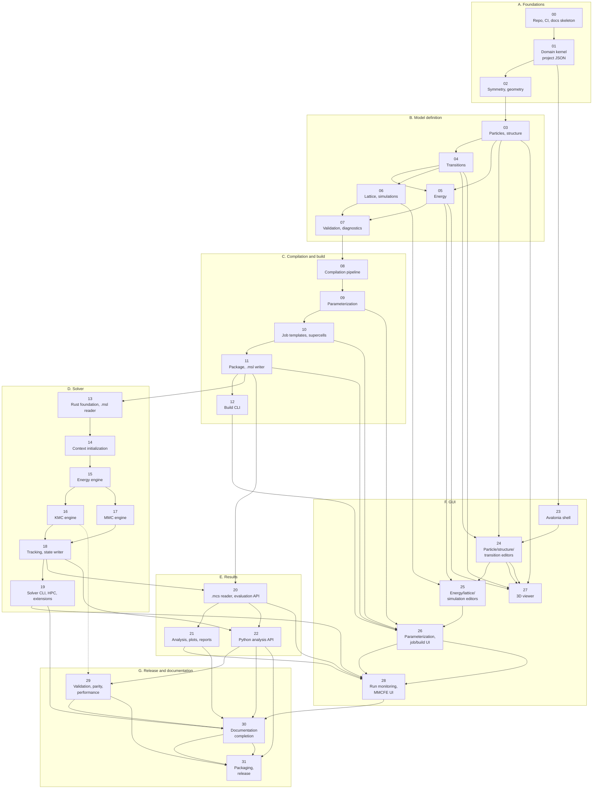

# 04 — Roadmap, Dependencies, and Milestones

## 1. Shape of the plan

The work is organised into seven phases and 32 steps. Each step is a shippable increment with a concrete
outcome, acceptance criteria, and tests. Steps are ordered by dependency, not by org chart. The critical path
runs through the model compiler and the solver; the GUI has a parallel track once the project format and
compiled model exist.

Edges show direct dependencies. Steps 22 (Python API) and 29 (validation) can run in parallel with the GUI
track; parity 29 consumes the solver/results steps 16–22, and the release step 31 consumes the documentation,
parity, and Python package outputs.

## 2. Phase overview

| Phase | Steps | Goal | Exit criterion |
| --- | --- | --- | --- |
| A. Foundations | 00–02 | Repo, domain kernel, format, symmetry | A minimal project round-trips and a space-group orbit expands correctly |
| B. Model definition | 03–07 | All user model domains and validation | The ceria model can be authored and validated headlessly |
| C. Compilation and build | 08–12 | Compiled model, templates, supercells, `.msl` | A valid `.msl` with N jobs is produced from a project |
| D. Solver | 13–19 | Rust KMC/MMC, tracking, state, CLI | A job runs to completion and writes a valid `.mcs` |
| E. Results | 20–22 | Reader, evaluation, analysis, Python API | Results can be evaluated from .NET and Python |
| F. GUI | 23–28 | Full Avalonia application | A user can complete the whole workflow in the GUI |
| G. Release and documentation | 29–31 | Parity, documentation, packaging | Release gates pass, the docs site builds, and artifacts ship |

## 3. Step estimates and dependencies

Estimates are in **person-weeks (pw)** for an experienced developer familiar with the domain. They include
tests, documentation, and review, not project management. Ranges reflect uncertainty.

| Step | Outcome | Depends on | Estimate |
| --- | --- | --- | --- |
| 00 | Repository, solution/workspace, CI, ADRs, docs skeleton, fixtures | — | 2–3 pw |
| 01 | Domain kernel, IDs, diagnostics, project JSON v1 | 00 | 2–4 pw |
| 02 | Space groups, geometry, coordinate encoding, orbit reduction | 01 | 3–5 pw |
| 03 | Particle and structure models | 02 | 2–4 pw |
| 04 | Transition model | 03 | 3–5 pw |
| 05 | Energy model | 03, 04 | 2–4 pw |
| 06 | Lattice and simulation models | 03, 04 | 1–3 pw |
| 07 | Validation, diagnostics, model statistics | 03–06 | 2–3 pw |
| 08 | Compilation pipeline (P1, environments, interactions, rules) | 02–07 | 4–6 pw |
| 09 | Parameterization templates and signatures | 08 | 1–3 pw |
| 10 | Job templates, inheritance, supercell/doping generation | 06, 08, 09 | 3–4 pw |
| 11 | Compiled package encoding and `.msl` v1 writer | 08–10 | 3–4 pw |
| 12 | Build orchestration and `mocassin` CLI | 10, 11 | 1–3 pw |
| 13 | Rust workspace, `mocassin-sim`, `.msl` reader, job model | 11 | 2–4 pw |
| 14 | Simulation context initialization | 13 | 2–4 pw |
| 15 | Energy engine and field terms | 14 | 3–5 pw |
| 16 | KMC engine, pre-run, normalization, time | 15 | 4–6 pw |
| 17 | MMC engine and equilibrium breaking | 15 | 2–4 pw |
| 18 | Trackers, histograms, statistics, `.mcs` writer | 16, 17 | 3–5 pw |
| 19 | Production CLI, HPC helpers, extension ABI | 18 | 2–4 pw |
| 20 | `.mcs` reader and evaluation API | 18, 11 | 2–4 pw |
| 21 | Analysis queries, plots, exports | 20 | 2–3 pw |
| 22 | Python `.mcs` reader, basic evaluations, pytest, mkdocstrings | 18, 20 | 2–3 pw |
| 23 | Avalonia shell, project lifecycle, undo/redo | 01 | 3–5 pw |
| 24 | Particle, structure, transition editors | 23, 03, 04 | 4–6 pw |
| 25 | Energy, lattice, simulation editors | 24, 05, 06 | 3–5 pw |
| 26 | Parameterization, job templates, build/deploy UI | 25, 09–12 | 4–6 pw |
| 27 | 3D viewer and visualization | 24, 03–05 | 4–6 pw |
| 28 | Run monitoring, charts, MMCFE UI | 26, 19–21 | 3–5 pw |
| 29 | Statistical parity, performance, fuzzing, hardening | 16–22 | 3–5 pw |
| 30 | Documentation completion: coverage, cross-cutting pages, APIs, tutorials, publish | 19, 21, 22, 28 | 3–5 pw |
| 31 | Packaging, docs artifact, Python package, samples, release | 22, 29, 30 | 2–4 pw |

**Total:** roughly 81–124 person-weeks (about 1.6–2.4 person-years). With three experienced developers working
in parallel on model/compiler, solver, UI, and documentation, the calendar estimate is **10–13 months** including
integration, documentation, and release hardening. A single developer should expect **20–26 months**.

## 4. Milestones

| Milestone | After step | Demonstrable result |
| --- | --- | --- |
| **M0 — Skeleton builds** | 00 | `dotnet build`, `cargo test`, strict Zensical build, CI green on three OSes |
| **M1 — Project round-trip** | 01 | Create/open/save a project; stable canonical JSON |
| **M2 — Symmetry proven** | 02 | All 230 groups/settings validate; P1 expansion matches brute force |
| **M3 — Model authored** | 07 | Ceria model built via API/CLI and validated with zero errors |
| **M4 — Model compiled** | 08 | Compiled model report: positions, pairs, clusters, rules, indices |
| **M5 — First package** | 12 | `.msl` with one job and a JSON manifest |
| **M6 — First KMC run** | 16 | Job completes; energy/acceptance counters look sane |
| **M7 — First MMC run** | 17 | MMC equilibrates a small system; energy trace converges |
| **M8 — Results loop** | 20 | `.mcs` read back; particle counts, MSD, conductivity evaluated |
| **M9 — Python API** | 22 | Read `.mcs` files and run basic multi-file evaluations from Python |
| **M10 — MVP GUI** | 26 | Create → validate → parameterize → build → run → collect in Avalonia |
| **M11 — Visualization** | 27 | 3D cell/sites/transitions/clusters/overlays with picking |
| **M12 — Feature parity** | 28 | Every parity-matrix item implemented or explicitly deferred |
| **M13 — Documentation** | 30 | Completed Zensical site with guides, physics, tutorials, APIs including Python |
| **M14 — Release** | 31 | Statistical parity, performance, packaged binaries, documentation artifact, Python package |

## 5. Parallel work plan

Assuming three core developers plus documentation ownership (shared or dedicated):

### Track A — Model and compilation (.NET)

Steps 00→01→02→03→04→05→06→07→08→09→10→11→12, then support 23–25.

### Track B — Solver (Rust)

Starts after step 11 freezes the package contract. Can begin earlier with a mock package generated from a
fixture. Steps 13→14→15→16→17→18→19, then 29.

### Track C — UI (Avalonia)

Starts after step 01 with the shell and project lifecycle (23). Consumes step 03/04/05/06 APIs as they land
(24–25), then 09–12 for 26, then 20–21 for 28. Step 27 (3D) starts after 24 and runs in parallel.

### Track D — Documentation

Step 00 creates the Zensical skeleton, navigation, build scripts, and Docs CI job. Each feature step writes
its pages as it lands and keeps the strict build green; step 30 completes cross-cutting content, integrates
the final DocFX/rustdoc/mkdocstrings outputs, and publishes after steps 19/21/22/28. Step 31 packages the
site with the release.

### Integration points

- **Contract review after step 11.** .NET and Rust teams sign off on the `.msl` schema and fixture.
- **Contract review after step 18.** .NET and Rust teams sign off on the `.mcs` MessagePack schema and fixture.
- **Weekly cross-track build.** A script builds the ceria project, runs one KMC and one MMC job, collects,
  evaluates, and compares against the previous week's observables.

## 6. Critical path and schedule risks

Critical path: **01 → 02 → 03 → 04 → 05 → 08 → 09 → 10 → 11 → 13 → 14 → 15 → 16 → 18 → 20 → 21 → 22 → 30 → 31**.
Parity (29) runs in parallel and feeds the release gate.

The highest-schedule-risk items are:

1. **Step 08 (compilation)** — symmetry reduction and rule generation are the most intricate algorithms.
   Mitigation: start with the ceria model and brute-force oracles; add vehicle/interstitialcy later.
2. **Step 16 (KMC)** — correctness of normalization, time step, and selection semantics. Mitigation: small
   analytic systems and per-cycle trace comparisons.
3. **Step 27 (3D)** — renderer scope. Mitigation: spike in week 1 of the step; fall back to a simpler
   instanced renderer if the backend integration is unstable.
4. **Step 29 (parity)** — statistical validation can reveal deep issues late. Mitigation: run parity checks
   continuously from step 16, not only at the end.
5. **Step 22 (Python API)** — schema drift between the Rust writer, .NET reader, and Python reader. Mitigation:
   one shared fixture set and cross-language tests from the first implementation.

## 7. Definition of done for every step

A step is done only when:

- [ ] The public API/types are implemented and documented.
- [ ] Unit and property tests cover the new behaviour.
- [ ] Contract/golden fixtures are updated if the step touches a format.
- [ ] The step's acceptance criteria are demonstrated in a CLI command or test.
- [ ] No new warnings; analyzers and clippy are clean.
- [ ] The step page is updated with actual outcomes and any deviations.
- [ ] The parity matrix is updated.
- [ ] A reviewer has checked the scientific semantics, not only the code.

## 8. Change control

- Scope changes go through the parity matrix and an ADR if they affect architecture or formats.
- Estimates are revisited at each milestone; the roadmap is a living document.
- Deferring a feature requires an explicit "deferred" entry with a rationale and a target release.
- Adding a feature not present in the original requires an ADR and a note in the parity matrix under
  "improvements", so it is not mistaken for parity work.
