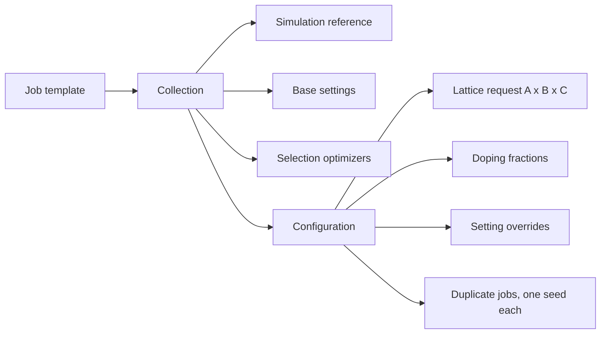

# Job Templates and Supercells

A job template is a reusable parameter sweep. The build expands one template into a deterministic list of
simulation jobs, and each job receives its own initial supercell. The template stores the *request* (simulation,
settings, cell size, doping fractions, optimizers); it never stores expanded jobs, generated lattices, or seeds.



## Template, collections, and configurations

A project may contain several templates. A template owns collections, a collection binds one simulation and
owns configurations, and a configuration supplies the supercell request and its doping fractions:

- **Template** — identity and name. Templates sort by `id` in canonical JSON.
- **Collection** — a named group that shares a simulation, base settings, an optional job count, an optional
  seed text, and the KMC selection optimizers. Collections keep authored order, which is the expansion order.
- **Configuration** — a named lattice request `(a, b, c)`, an ordered list of requested doping fractions, and
  optional setting overrides. Configurations keep authored order.
- **Duplicate job** — one repeated execution of a configuration. Duplicates share every setting and lattice
  request but receive different seeds.

Collection names must be unique within a template and configuration names unique within a collection
(`JOB007`). A template without collections is `JOB001`; a collection without configurations is `JOB003`; a
collection that references an unknown simulation is `JOB002`.

Templates are project data, not compiled data. The GUI editor for them belongs to Step 26; the JSON shape and
the build path are available now.

## Settings inheritance

Effective settings are resolved in this order:

1. the compiled simulation's runtime defaults;
2. the collection `baseSettings`;
3. the configuration `overrides`;
4. the duplicate job (seed only; a duplicate never changes settings).

A field that is absent or `null` inherits. An explicit `0`, `false`, or `ExecutionFlags.None` is a real override
and stops inheritance for that field. Settings are validated per layer against the same hard
ranges as [simulations](simulations.md); a value outside its range, a missing required value after resolution,
or a KMC-only field on an MMC collection (or the reverse) is `JOB015`.

The shared fields are `temperatureK`, `targetMcsp`, `writeOutCount`, `timeLimitSeconds`, `minSuccessRate`,
`flags`, and `instruction`. KMC adds `preRunMcsp`, `electricFieldModulusVm`, `electricFieldDirection`,
`normalizationEnergyEv`, and `maxAttemptFrequencyHz`. MMC adds `breakTolerance`, `breakSampleLengthMcsp`,
`breakSampleIntervalMcsp`, and `resultSampleMcsp`.

### Extensions

`extensions` lives inside `baseSettings`/`overrides`, not beside them. `null` inherits. A non-null array
**replaces** the inherited list as a whole, including an empty array. Each entry is `{ "id": "…", "config": { … } }`:
the id is unique and at most 64 characters, `config` is a JSON object of at most 64 KiB, at most 16 entries are
allowed, and the total is at most 256 KiB (`JOB018`). The object is stored as canonical JSON with sorted
properties, so an extension edit changes the project hash deterministically. The concrete extension schema is
owned by the extension consumer (Steps 27/28); Step 10 validates only the envelope.

## Job counts, IDs, and names

The effective job count is `jobCountPerConfig` when present, otherwise the simulation's `jobCount`. It must be
in `1..1000` (`JOB008`). A collection with *n* configurations and an effective count *k* expands to
*n × k* jobs.

Expansion walks collections in authored order, configurations in authored order, and duplicates in ascending
`jobIndex`. `JobId` is 1-based across the complete template and is the solver's `--job` argument. For example,
if the first collection has two configurations with two duplicates each, jobs 1–4 belong to that collection and
the next collection starts at job 5. Inside one configuration, `jobIndex` is the 0-based duplicate index.

Every descriptor also carries `collectionIndex`, `configIndex`, the authored collection/configuration names, the
simulation id and compiled index, and the compiled kind. The names are descriptive; identity is the numeric job
id.

A template that expands past 99,999 jobs is `JOB019`; above 10,000 jobs the build warns with `JOB013`.
Expansion validates every configuration before emitting the first descriptor, so invalid data returns
diagnostics and no partial job list.

## Seeds

Builds are reproducible without storing a seed per job. The master seed text is the first non-empty value of:

1. the collection `rngSeed`;
2. the compiled simulation's `rngSeed`;
3. the project `masterSeed`.

The project seed is required and is 32 bytes of lowercase hexadecimal. A seed text that is exactly 64 lowercase
hex characters is decoded to its 32 bytes. Every other explicit text is hashed as
`SHA-256("mocassin/seed-text/v1" || UTF-8(text))`, so friendly texts such as `ceria-seed-1` are allowed without
making the derivation depend on which other layer changed.

The job seed is then derived from the master seed and the job coordinates:

$$
\mathrm{jobSeed} = \operatorname{SHA256}\bigl(
  \mathrm{master}[32] \;\|\;
  \mathrm{u32le}(\mathrm{collectionIndex}) \;\|\;
  \mathrm{u32le}(\mathrm{configIndex}) \;\|\;
  \mathrm{u32le}(\mathrm{jobIndex}) \;\|\;
  \mathrm{UTF8}(\texttt{"mocassin/job/v1"})
\bigr)
$$

The lattice seed is derived from the job seed and a parameterization-independent lattice-request hash. Changing
an energy or a temperature therefore does not change the lattice for the same job, while changing the cell size,
the doping fractions, the particle/structure definitions, or the symmetry catalog does. The full byte layout is
in the [project format reference](../reference/project-format.md#job-templates-step-10-fields) and the
[compilation pipeline](../development/compilation-pipeline.md#job-expansion-and-supercells-step-10).

The build never creates, stores, or reuses a seed from a previous build. The same descriptor and seed produce an
identical lattice across runs and operating systems.

## Lattice requests and dopings

`lattice` is a cell count, not a length: `A × B × C` unit cells, never `A + B + C`. Each count is in `1..256`;
the product with the compiled P1 position count must stay within 500,000 positions (`JOB004`). Above 100,000
positions the build warns with `JOB014`.

`dopings` is an ordered list of `{ dopingId, fraction }` pairs. The doping definition itself lives in the model
(see [Lattice and doping](lattice.md)); the configuration supplies only the fraction. Fractions must be finite
and in `[0, 1]` (`JOB005`), and a doping may appear only once per configuration (`JOB017`). An unknown reference
is `JOB006`. Dopings are applied in ascending authored doping priority, so the JSON order is normalised to
priority order by the writer.

A valid request always produces counts and a report, even when the applied count is zero. Unrealizable requests
warn (`JOB010`, `JOB011`, `JOB016`) or fail (`JOB012`); the precise semantics are in
[Lattice and doping](lattice.md#supercell-generation).

## Selection optimizers

A selection optimizer removes one particle at a stable reference site from the KMC start-option pool. It never
removes the particle from the lattice. The project stores `(siteId, particleId)`; the compiled job expands it to
the compiled particle index at every canonical P1 image of that site. Duplicate pairs are `JOB017`; an unknown
site/particle or a particle the site cannot occupy is `JOB009`.

The optimizers affect the compiled dual-degree-of-freedom flag. The flag starts from the simulation intent
(`true` for KMC, `false` for MMC). It is cleared only when at least one optimizer exists **and every** compiled
environment is reduced by an optimizer. If any environment is unchanged, including the mixed case, the flag
stays set. MMC ignores optimizers entirely.

A KMC collection whose optimizers leave no selectable start option for a required mechanism is `JOB009`. The
build-preview report shows the target count and the removed-start count for each optimizer, and whether the
dual-DOF flag was cleared.

## Preview before building

`mocassin build --preview` runs the same load, validation, compilation, expansion, and generation path as a
build but never opens or writes a `.msl` package. A project with several templates requires `--template`; a
project with exactly one template may omit it. The report covers the template job count, every collection's
dual-DOF flag and optimizer effects, and every configuration's cell size, position count, doping counts, charge
before/after, and neutrality. See the [CLI reference](../reference/cli.md).

The shared preview service used by the GUI and CLI returns the same `DopingReport` as generation, so preview and
build cannot diverge. Invalid user data returns no preview rather than a partial one.

## Limits

| Limit | Value | Diagnostic |
| --- | ---: | --- |
| Templates per project | 100 | `JOB020` |
| Collections per template | 100 | `JOB020` |
| Configurations per collection | 1,000 | `JOB020` |
| Dopings per configuration | 1,000 | `JOB020` |
| Selection optimizers per collection | 1,000 | `JOB020` |
| Jobs per configuration (effective) | 1,000 | `JOB008` |
| Expanded jobs per template | 99,999 | `JOB019` |
| Expanded jobs warning | 10,000 | `JOB013` |
| Cell count per axis | 256 | `JOB004` |
| Positions per supercell | 500,000 | `JOB004` |
| Positions warning | 100,000 | `JOB014` |
| Extensions per effective settings list | 16 / 256 KiB | `JOB018` |

Counts are checked in 64-bit arithmetic before allocation. The structural rules (`JOB001`–`JOB008`, the
reference half of `JOB009`, `JOB015`, `JOB017`, `JOB018`, `JOB020`) are reported by `validate` without a compiled
model. The compiled-bound checks (`JOB004` total-position cap, `JOB009` removes-all, `JOB010`–`JOB014`, `JOB016`,
`JOB019`) require the build path. The full catalogue is in [Diagnostics](../reference/diagnostics.md).

## Example

`samples/jobs/ceria-temperature-sweep.mocprj` defines two KMC collections at 773 K and 973 K, two lattice sizes,
1–3 % compensated Ce⁴⁺ → Ce³⁺ reduction, duplicate jobs, a collection seed, and a Ce-site optimizer. It expands
to six jobs across two collections and four configurations:

```bash
mocassin build samples/jobs/ceria-temperature-sweep.mocprj --preview
mocassin build samples/jobs/ceria-temperature-sweep.mocprj --preview --json
```

The raw JSON shape, canonical ordering, and the extension bounds are documented in the
[project format reference](../reference/project-format.md#job-templates-step-10-fields).
